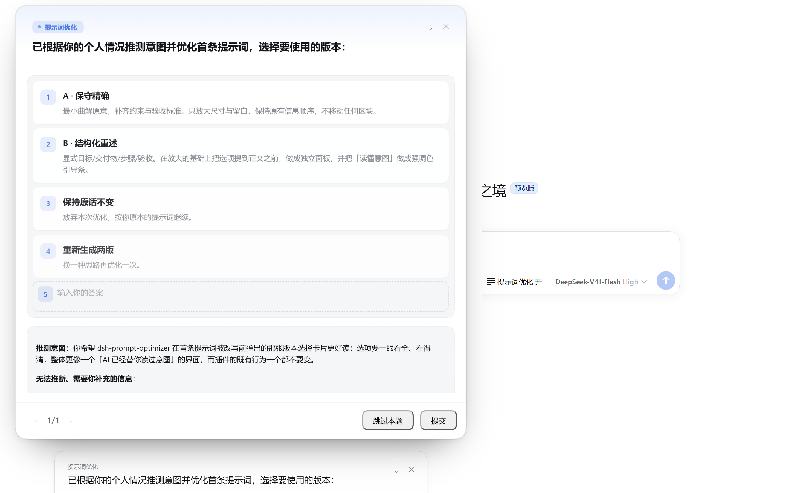
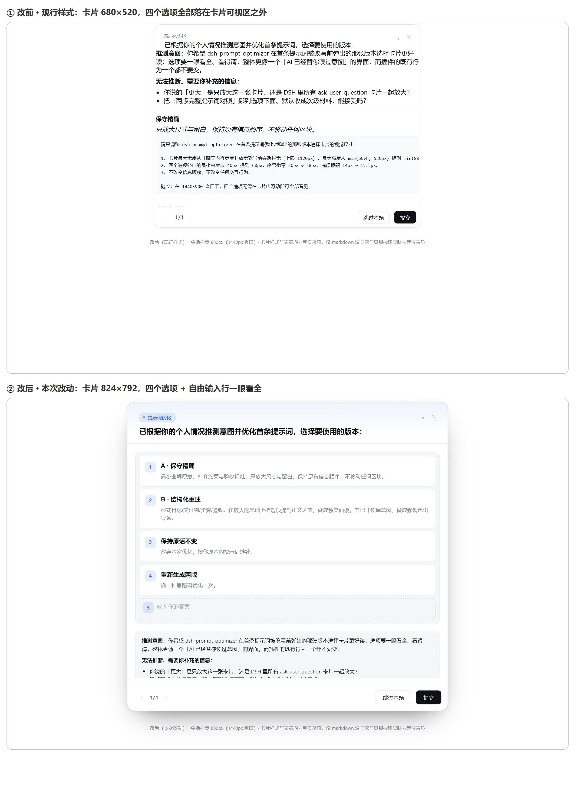

# dsh-prompt-optimizer

**DeepSeek Harness（DSH）的首条提示词优化器插件。**

每次新会话的第一条提示词不会直接发给模型：插件会先读你写的「个人画像」，推测你真正想做成什么，给出两个固定版本的改写——**A《保守精确》** 和 **B《结构化重述》**——用一张卡片让你挑。你选定之后，模型看到的、会话日志记下的，都是你选中的那一版。

如果你想要的是「一按发送，AI 就替我把需求说清楚」，这个插件就是干这个的。



> 上面是真实界面截图：卡片里两版改写的定位、`missing`（画像推断不出来、需要你补的信息），以及「保持原话不变 / 重新生成两版 / 自由改写」三个出口。



---

## 一、这个插件是什么（先看清楚再装）

| 问题 | 答案 |
|---|---|
| 能单独运行吗？ | **不能。** 它是 DSH 的插件，必须挂在 DSH 的 profile 里才有意义。没有 DSH 就装不上 |
| 需要编译 / 构建吗？ | **不需要。** 客户端那半边是手写的 `__ModuleLoader__` bundle，装完重启宿主即可，仓库里没有构建脚本 |
| 需要 `npm install` 装依赖吗？ | **不需要。** 它用的是宿主注入的服务（`llm` / `userQuestions` / `commands` / `webServer`），运行时去 profile 的 `node_modules` 里找 DSH 自带模块 |
| 会把我原来的提示词弄丢吗？ | 不会。任何一步失败——没画像、模型超时、JSON 不合法、你把卡片关了——都退化成「按你的原话继续」 |
| 会花钱吗？ | 每次首条提示词会额外发一次辅助模型请求。默认走 `deepseek-flash` + `low` 思考档，且**只对会话首条提示词**生效；斜杠命令不消耗 token |

## 二、环境要求

| 项目 | 要求 | 怎么查 |
|---|---|---|
| 操作系统 | Windows / macOS / Linux 都行（路径处理用 `node:path` 与 `node:os`） | — |
| Node.js | **≥ 22.19.0**（实测 24.15.0 正常） | `node -v` |
| DSH | **≥ 0.1.2-rc.1**（实测 0.2.0-rc.2 正常） | `dsh --version` |
| 包管理器 | pnpm 或 npm 都行（DSH profile 用 pnpm） | `pnpm -v` |

装之前先确认这两条命令能正常输出：

```bash
node -v
dsh --version
```

如果 `dsh --version` 报「找不到命令」，先装 DSH，再回来装本插件。

## 三、安装（照着做，五步）

### 第 1 步：拿到这个项目

```bash
git clone https://github.com/phy1234669/dsh-prompt-optimizer.git
```

没有 git 也可以用 GitHub 页面上的 **Code → Download ZIP**，解压到任意目录。下面把解压/克隆后的目录称为 `<插件目录>`。

### 第 2 步：找到你的 DSH profile 目录

DSH 的 profile 默认在用户目录下：

| 系统 | profile 目录 |
|---|---|
| Windows | `C:\Users\<你的用户名>\.dsh\profiles\web` |
| macOS / Linux | `~/.dsh/profiles/web` |

用命令确认（Windows PowerShell）：

```powershell
Test-Path "$env:USERPROFILE\.dsh\profiles\web"
```

输出 `True` 就对了。DSH 的 Web GUI 用的就是 `web` 这个 profile。

### 第 3 步：把插件登记进 profile

用文本编辑器打开 `<profile 目录>/package.json`，在 `dependencies` 里加一行，把 `<插件目录>` 换成第 1 步的真实路径：

```json
{
  "name": "dsh-profile-web",
  "private": true,
  "dependencies": {
    "dsh-prompt-optimizer": "file:<插件目录>"
  },
  "dsh": {
    "profile": {
      "bundles": [
        "@deepseek-ai/dsh-base",
        "@deepseek-ai/dsh-web-app",
        "dsh-prompt-optimizer"
      ],
      "patchReload": "live"
    }
  }
}
```

> **注意两点**，这是新手最容易错的地方：
> 1. `dependencies` 里的键名必须是 `dsh-prompt-optimizer`（和插件包名一字不差）。
> 2. `dsh.profile.bundles` 数组里也要加上同一个名字——**只加 dependencies 不生效**。
>
> 另外：你 profile 里原本可能已经有 `bundles` 数组（例如 `@deepseek-ai/dsh-base`），**保留原有内容，只在末尾追加一行**，不要整个替换掉。

Windows 路径里的反斜杠要写成双反斜杠或正斜杠，例如：

```json
"dsh-prompt-optimizer": "file:D:/dsh-prompt-optimizer"
```

### 第 4 步：安装链接

在 profile 目录里执行（用 pnpm 或 npm 都可以）：

```powershell
cd "$env:USERPROFILE\.dsh\profiles\web"
pnpm install
```

跑完之后，profile 的 `node_modules` 里会出现 `dsh-prompt-optimizer`，它指向第 1 步的 `<插件目录>`。

### 第 5 步：重启 DSH 宿主

**必须重启**。宿主插件是新路由，改完不重启不会生效（客户端那半边首次装载也要重启）。

关掉 DSH Web 服务再启动，或者直接用你自己的启动脚本重启。

## 四、确认装好了

重启后，在 DSH 的输入框里输入斜杠命令：

```
/optimize status
```

出现下面这样的输出就说明插件在工作（这是真实输出，数字会不同）：

```
提示词优化：已开启
路由：deepseek-official / deepseek-flash
画像文件：
✗ <你的用户目录>\.dsh\AGENTS.md（未找到）
✗ <你的工作目录>\AGENTS.md（未找到）
✗ <你的工作目录>\dsh-prompt-optimizer\persona.md（未找到）
首条提示词判定（最近 12 条，本进程）：
  （本进程还没有收到任何首条提示词）
依赖解析（/optimize diag 可看完整）：
  ...
```

**三条画像文件全是 `✗` 是正常的**，因为你还没写画像（下一步就写）。

如果这里报「未知命令」或者完全没反应，跳到本文最后的「常见问题」。

另外，输入框发送键左边会出现一个开关：

```
⋯ [⚡ 提示词优化 开]  [模型 ▾]  [发送]
```

文字标签始终可见，点击即可开关，状态会落盘（刷新页面、重启宿主都保持）。

## 五、第一次使用

### 1）写你的个人画像

插件靠画像来「推测你的真实意图」，**没有画像它就没什么可补的**。仓库里给了一份空模板 `persona.example.md`，复制一份开始填：

```powershell
cd <插件目录>
Copy-Item persona.example.md persona.md
```

然后用编辑器打开 `persona.md`，把三段填上：

| 段落 | 填什么 | 影响什么 |
|---|---|---|
| 一、事实 | 你是谁、在做什么、机器与目录环境 | 补全隐含需求（「生成物别放 C 盘」这类） |
| 二、判断 | 你的决策风格、沟通习惯、交付偏好 | 决定优化方向（该给对比还是给方案、该先问还是先动手） |
| 三、推断规则 | 你反复要交代的固定要求 | 每次都自动补进提示词，不用重复交代 |

`persona.md` 已经在 `.gitignore` 里，**不会被提交**，可以放心写真实内容。

> 画像文件默认从三个位置按「广 → 窄」叠加读取，最具体的优先级最高：
> `~/.dsh/AGENTS.md` → `{会话工作目录}/AGENTS.md` → `{会话工作目录}/dsh-prompt-optimizer/persona.md`
>
> 找不到的文件会静默跳过，不会报错。总上限默认 16 KB，从最具体的那层往前分配预算。

**画像放哪儿**：默认路径里的 `{会话工作目录}` 是你的会话工作目录，不一定是插件目录。两种办法：

- 把 `persona.md` 放到会话工作目录下的 `dsh-prompt-optimizer/` 里；
- 或者干脆在配置里写死绝对路径（见下一节 `personaFiles`）。

用 `/optimize status` 可以随时看这三个候选文件到底在不在、路径是什么。

### 2）发一条正常的首条提示词

新开一个会话，随便写一条**不少于 15 个字符**的提示词（比如「帮我写一个把 CSV 转成 Markdown 表格的脚本」）。几秒后会弹出选择卡片：

- **A · 保守精确**：保留你的措辞和意图，只补齐隐含约束、边界条件、验收标准
- **B · 结构化重述**：重述为目标 / 交付物 / 约束 / 步骤 / 验收 / 假设
- **保持原话不变**：放弃本次优化
- **重新生成两版**：再优化一次（最多连续 3 次）
- **第 5 项输入框**：直接写你自己想要的第三个版本

选定后，进入本步的就是你选的那一版。

### 3）看改动记录

输入框下方会出现一条变更提示，10 秒后折叠成一行，点「查看对比」能看到**原话与选定版本的完整对照**。历史同时写进 `~/.dsh/prompt-optimizer.json`。

## 六、配置（全部可选）

改法：在 profile 的 `cordis.patch.yml` 里按 id 覆盖，或在 profile 的 `package.json` 里改。

```yaml
- id: prompt-optimizer
  config:
    model: deepseek-flash
    minPromptChars: 15
```

| 字段 | 默认值 | 含义 |
|---|---|---|
| `enabled` | `true` | 宿主启动时的开关；一旦有落盘状态就以落盘状态为准 |
| `provider` / `model` | `deepseek-official` / `deepseek-flash` | 辅助优化请求的路由，与你的主对话模型独立 |
| `reasoningEffort` | `low` | 辅助请求的思考档位，压低延迟 |
| `maxOutputTokens` | `6000` | 辅助请求输出上限（契约要装下两版完整提示词） |
| `timeoutMs` | `60000` | 辅助请求总超时 |
| `maxInputBytes` | `24000` | 送进优化器的输入总上限 |
| `maxContextBytes` | `16000` | 画像上下文上限 |
| `personaFiles` | 见上文 | 画像候选文件，最具体的放最后 |
| `minPromptChars` | `15` | 短于此长度不打扰你 |
| `keepOriginal` | `true` | 是否把原话写进 `prompt-optimizer.json` 审计历史 |
| `stateFile` | `~/.dsh/prompt-optimizer.json` | 开关与审计历史的落盘位置 |

## 七、命令

| 命令 | 作用 |
|---|---|
| `/optimize` 或 `/optimize status` | 开关状态、模型路由、每个画像文件是否存在、最近 12 条首条提示词判定 |
| `/optimize on` | 全局开启（落盘） |
| `/optimize off` | 全局关闭（落盘） |
| `/optimize once` | 只对下一条首条提示词生效一次 |
| `/optimize diag` | 打印完整依赖解析诊断（插件加载异常时用） |

`/optimize status` 里那份判定列表是「我的提示词为什么没被优化」的第一现场，它会把每种跳过都写明原因：

```
首条提示词判定（最近 12 条，本进程）：
  11:51:52  进入优化流程（turn=1, step=1, 25 字符）  [session-…]
  11:51:53  跳过：只优化会话首条提示词（本条是第 2 轮）（turn=2, step=1）  [session-…]
  11:51:53  跳过：提示词短于 15 字符（turn=1, step=1, 6 字符）  [session-…]
  11:51:53  跳过：提示词优化开关是关闭的（可用 /optimize on 开启）（turn=1, step=1）  [session-…]
```

有一条「进入优化流程」就说明拦截器确实在工作；只有跳过、没有进入，原因就在括号里。

## 八、常见问题

**Q：输入框旁边没有那个「提示词优化」开关。**
客户端那半边没加载。先确认 profile 的 `dsh.profile.bundles` 里加了 `dsh-prompt-optimizer`（只加 dependencies 不够），然后**重启宿主**（不是刷新页面）。

**Q：命令面板里没有 `/optimize`。**
宿主插件没挂载。检查三件事：① package.json 的键名拼写；② `pnpm install` 是否成功跑完、profile 的 `node_modules` 里有没有这个目录；③ DSH 版本是否 ≥ 0.1.2-rc.1。然后用 `/optimize diag` 看依赖解析的失败原因。

**Q：插件加载了，但提示词从来没被优化过。**
按顺序排查：① `/optimize status` 里开关是不是「已关闭」→ `/optimize on`；② 那三个画像文件是不是全是 `✗` → 先写 `persona.md`；③ 提示词是不是短于 15 个字符（可以调小 `minPromptChars`）；④ 是不是只对**会话首条**生效，你已经问到第 2 轮了。

**Q：卡片弹出来了，但优化失败。**
失败原因会写进变更提示条和历史落盘文件。看错误码：`TIMEOUT_OR_ABORT` 是辅助请求超时（可调大 `timeoutMs`）；`BAD_JSON` 会附上模型原始输出的开头 200 字符，能一眼看出是被截断还是键名漂了；`CALL_FAILED` 是请求本身失败（检查 `provider` / `model` 路由是否正确）。

**Q：能不能只优化某些会话？**
可以。`/optimize off` 全局关闭，然后用 `/optimize once` 单独给下一条首条提示词开一次。

**Q：`~/.dsh/prompt-optimizer.json` 里存了什么？**
开关状态和审计历史（最近 50 条），包括每次「优化成功 / 保持原话 / 跳过 / 失败」的判定。里面可能有你的原始提示词文本——不想留就把 `keepOriginal` 设成 `false`。

## 九、项目结构

```
dsh-prompt-optimizer/
├── package.json           插件清单（npm 发布元数据 + dsh 字段）
├── cordis.patch.yml       被登记为 profile bundle 时的挂载声明
├── lib/
│   ├── index.js           宿主插件主体：pre-step 拦截、HTTP 路由、/optimize 命令
│   ├── client.js          浏览器那半边（手写 __ModuleLoader__ bundle，无需构建）
│   ├── config.js          配置默认值、开关与审计历史的落盘
│   ├── optimizer.js       辅助优化请求（超时、JSON 容错、重采一次）
│   ├── persona.js         画像三层叠加与字节预算
│   ├── prompt.js          两版变体的契约与对照渲染
│   └── resolve.js         跨盘 / 跨目录的 DSH 内部模块解析
├── persona.example.md     个人画像空模板（复制成 persona.md 再用）
├── docs/shots/            README 里的截图
└── LICENSE
```

## 十、工作原理（想深究再看）

| 关注点 | 做法 |
|---|---|
| 拦截点 | `agent/pre-step` waterfall，`{ prepend: true }`，先 `next()` 尊重下游，再替换自己关心的那条消息；图片、文件块原样保留，只替换文本块 |
| 幂等 | `turn === 1` 加会话标记双保险；热重载、重跑同一步、并发监听都不会问你第二次 |
| 选择卡片 | 走 `ctx.userQuestions.ask()` 的 `detail` 字段（面向模型的 `ask_user_question` 工具没有这个字段） |
| 与 UI 通信 | `ctx.webServer.register` 注册三个 exact 路由，客户端 `fetch` 轮询（2 秒，页面隐藏时暂停） |
| 状态落盘 | 串行化写入链 + 临时文件 rename，避免同一 tick 内多条事件竞争同一个目标 |
| 绝不阻塞 | 任何失败都退化为「按原话继续」，插件不会是干活的单点故障 |

## 十一、许可

[MIT](LICENSE)。欢迎提 issue 和 PR。
